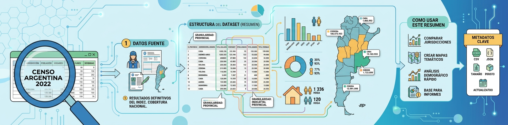

<p align="center">

</p>

# Censo Argentina 2022: resúmenes provinciales y departamentales

Estadísticas del Censo Nacional de Población, Hogares y Viviendas 2022 para comparar territorios y vincularlas con los datos geográficos del repositorio. Incluyen población, edad, educación, viviendas, hogares y servicios.

## Archivos principales

| Archivo | Filas | Columnas | Unidad de cada fila |
|---|---:|---:|---|
| [provincias_resumen.csv](provincias_resumen.csv) | 24 | 29 | Provincia o CABA |
| [departamentos_resumen.csv](departamentos_resumen.csv) | 529 | 32 | Departamento, partido o comuna |
| [provincias_completo.csv](provincias_completo.csv) | 24 | 125 | Provincia o CABA |
| [departamentos_completo.csv](departamentos_completo.csv) | 529 | 128 | Departamento, partido o comuna |

Las versiones **`_resumen`** incluyen una selección compacta para comparar territorios y preparar visualizaciones. Las versiones **`_completo`** conservan todas las columnas de la versión amplia anterior, incluidos los desgloses de vivienda, tenencia, educación y servicios. Comparten los mismos códigos y filas: son dos versiones de las mismas unidades, no conjuntos que deban concatenarse.

Las ocho columnas provinciales originales y sus valores se conservan en `provincias_completo.csv`. La versión compacta selecciona únicamente los atributos indicados a continuación.

Los 529 registros subprovinciales corresponden a **379 departamentos, 135 partidos de Buenos Aires y 15 comunas de CABA**. Cada fila contiene estadísticas de toda esa unidad territorial. No representa necesariamente a su ciudad cabecera ni a una localidad del mismo nombre.

### Documentación de apoyo

| Archivo | Contenido |
|---|---|
| [diccionario_variables.csv](diccionario_variables.csv) | Definición, tipo, unidad, universo y procedencia de cada columna |
| [fuentes.csv](fuentes.csv) | Catálogo de los cuadros oficiales utilizados y sus enlaces de descarga |
| [validacion.json](validacion.json) | Resultados de las comprobaciones y cobertura de los datos |
| [variantes_historicas.json](variantes_historicas.json) | Diferencias detectadas entre presentaciones alternativas de algunos cuadros históricos |

`Islas del Atlántico Sur` se conserva en el catálogo para que los códigos coincidan con el GeoJSON. El INDEC informa que no pudo realizar el operativo censal en esa área. Sus celdas de población quedan vacías, sin inventar valores. Algunas tablas temáticas tampoco presentan datos para Antártida Argentina.

## Vinculación con argentina_geo

- `provincias_resumen.csv.codigo` se une con `provincias.geojson.properties.id`.
- `departamentos_resumen.csv.codigo` se une con `departamentos.geojson.properties.id`.
- `departamentos_resumen.csv.codigo_provincia` se une con `provincias_resumen.csv.codigo`.
- `localidades.csv.departamento_id` se une con `departamentos_resumen.csv.codigo`.

Se verificó la correspondencia de los 24 códigos provinciales y los 529 códigos subprovinciales con los GeoJSON de `../argentina_geo`. Conservar los códigos como texto para mantener ceros iniciales. No unir por nombre. Unir una estadística departamental a localidades repite el valor del departamento y no lo convierte en una estadística de cada localidad.

## Selección de las versiones compactas

Ambos resúmenes comparten 27 variables estadísticas. Provincia tiene dos columnas identificatorias y departamento tiene cinco.

| Grupo | Columnas |
|---|---|
| Población | `poblacion`, `varones`, `mujeres`, `vivienda_particular` |
| Territorio | `superficie_km2`, `densidad_hab_km2` |
| Evolución | `poblacion_2010`, `variacion_relativa_pct` |
| Edad | `edad_mediana` y los ocho porcentajes de rangos de edad detallados más abajo |
| Viviendas y hogares | `viviendas_total`, `viviendas_ocupadas`, `hogares_total` |
| Servicios | `pct_hogares_agua_red`, `pct_hogares_cloaca`, `pct_hogares_cocina_gas_red`, `pct_hogares_internet` |
| Condiciones habitacionales | `pct_hogares_propietarios`, `pct_hogares_sin_bano` |
| Educación | `pct_asistencia_escolar_6_17` |

`pct_asistencia_escolar_6_17` se calcula entre las personas de 6 a 17 años en viviendas particulares. Se suman exclusivamente las edades simples 6 a 17 y la categoría de sexo Total. En las versiones completas quedan sus conteos `poblacion_particular_6_17` y `asiste_6_17`, para poder sumar territorios y recalcular el indicador. No es una tasa de finalización escolar ni distingue el nivel al que asiste cada persona.

Las versiones completas son completas **respecto de la selección temática preparada para este repositorio**: no incluyen todas las variables, cruces ni microdatos del Censo 2022. Tampoco incluyen estadísticas censales propias de cada localidad.

## Variables

La definición de cada columna está en `diccionario_variables.csv`, que identifica archivo, tipo, unidad, universo y procedencia.

| Grupo | Variables incluidas |
|---|---|
| Población | Total, sexo registrado al nacer, residencia en viviendas particulares y colectivas, situación de calle |
| Cambio intercensal | Población 2010, variación absoluta y relativa publicada entre 2010 y 2022 |
| Territorio | Superficie en km² y densidad oficial |
| Edad | Mediana total y por sexo; conteos amplios y porcentajes para los rangos 0–5, 6–11, 12–17, 18–29, 30–44, 45–64, 65–79 y 80 o más años |
| Educación | Asistencia escolar, nivel al que asisten, nivel completado de quienes ya no asisten pero asistieron |
| Viviendas | Total, particulares y colectivas, condición de ocupación, cantidad de hogares y tipos de vivienda |
| Hogares | Tenencia y documentación de propiedad, materiales del piso, cantidad de baños |
| Servicios | Agua y su procedencia, cloaca, combustible para cocinar, internet, computadora y celular con internet |
| Porcentajes | Hogares con agua de red, cloaca, gas de red para cocinar e internet; población particular de 65 años y más |

Las columnas originales `vivienda_particular` y `vivienda_colectiva` cuentan **personas**, no viviendas. En las versiones completas, `viviendas_particulares` y `viviendas_colectivas`, y en ambas versiones `viviendas_total`, sí cuentan viviendas.

El nivel educativo actual se refiere a quienes asisten. Las variables `ya_no_asiste_*` de las versiones completas describen a personas de 5 años y más que ya no asisten pero asistieron. No representan la distribución educativa de toda la población.

Los conteos amplios de edad y las edades medianas corresponden a población en viviendas particulares. Gas de red mide su uso como combustible principal para cocinar. Los porcentajes `pct_*` usan escala de 0 a 100 y los denominadores indicados en el diccionario.

### Rangos de edad

Las cuatro versiones incluyen las siguientes columnas. Los límites de cada rango son inclusivos.

| Columna | Edades |
|---|---|
| `pct_poblacion_0_5` | De 0 a 5 años |
| `pct_poblacion_6_11` | De 6 a 11 años |
| `pct_poblacion_12_17` | De 12 a 17 años |
| `pct_poblacion_18_29` | De 18 a 29 años |
| `pct_poblacion_30_44` | De 30 a 44 años |
| `pct_poblacion_45_64` | De 45 a 64 años |
| `pct_poblacion_65_79` | De 65 a 79 años |
| `pct_poblacion_80_mas` | 80 años o más |

El denominador es la **población en viviendas particulares** del territorio, publicada en la columna `vivienda_particular`. No es la columna `poblacion`, que incluye también población en viviendas colectivas y en situación de calle.

```text
porcentaje del rango = personas del rango en viviendas particulares
                      / población total en viviendas particulares × 100
```

Un valor de `7.5` significa **7,5 %**, no una proporción de 0,075 ni una cantidad de personas. Los valores se redondean a seis decimales.

Los rangos se construyen con edades simples de 0 a 99 y el tramo abierto de 100 años y más, sin sumar a la vez los subtotales quinquenales. No se superponen y cubren todas las edades. Sus porcentajes suman 100 %, con una tolerancia máxima de 0,0000041 puntos porcentuales por redondeo.

Se calcularon para las 24 jurisdicciones y 527 unidades subprovinciales. Las ocho columnas quedan vacías para Antártida Argentina e Islas del Atlántico Sur, porque el denominador no está publicado o es cero en el cuadro empleado. Cero personas en un universo no permite definir su distribución porcentual.

No sumar estos ocho porcentajes con `pct_poblacion_particular_65_mas`: ese indicador ya está contenido en los rangos de 65–79 y 80 o más. Para combinar territorios, sumar sus conteos de personas y recalcular el porcentaje; no promediar directamente los porcentajes territoriales.

### Localidades

Los resúmenes censales actuales llegan al nivel de provincia y departamento, partido o comuna. El archivo `../argentina_geo/localidades.csv` aporta identificación y ubicación de localidades, pero no contiene las estadísticas censales de estos resúmenes desagregadas por localidad. La construcción de un resumen censal por localidad queda para una etapa posterior.

## Fuentes y preparación

Fuente primaria: INDEC, resultados definitivos del Censo 2022. Se utilizaron los cuadros provinciales de estructura de la población, educación, condiciones habitacionales de los hogares y viviendas. El catálogo `fuentes.csv` contiene las URL oficiales, nombres de archivos y huellas SHA-256.

La base provincial original procede de [c2022_tp_c_resumen.xlsx](https://censo.gob.ar/wp-content/uploads/2024/01/c2022_tp_c_resumen.xlsx). La ampliación se apoya en los cuadros disponibles en el [portal de resultados definitivos](https://censo.gob.ar/index.php/datos_definitivos/).

Se seleccionaron los totales publicados de cada jurisdicción y sus unidades subprovinciales. Se sumaron grupos de edad no superpuestos y se calcularon porcentajes a partir de sus numeradores y denominadores. No se promediaron porcentajes departamentales para producir datos provinciales.

Se normalizaron nombres para vincular hojas con códigos, conservando la procedencia en las tablas de respaldo. En el cuadro bonaerense de conectividad, la hoja `Cuadro7.2.130` repite el título Tres de Febrero. Se identificó como Tres Lomas (06847) mediante su total de 3.539 hogares, coincidente con los cuadros de hogares y viviendas. Las comunas se identificaron por el número explícito del título, incluso cuando falta la coma en la fuente.

Las agrupaciones Antártida Argentina e Islas del Atlántico Sur de algunos cuadros intercensales no se atribuyeron íntegramente a ninguno de los dos departamentos. Por eso algunas estadísticas quedan vacías en esas filas. Los códigos y nombres de los resúmenes son compatibles con el catálogo geográfico.

## Ausencias, ceros y compatibilidad

- Las celdas vacías indican información no disponible en el cuadro utilizado o un dato que no corresponde presentar (`///`). No deben reemplazarse automáticamente por cero.
- El signo oficial `-`, cero absoluto, se convirtió a `0`.
- Se conserva la curaduría previa de `situacion_calle` en la versión provincial completa: las dos celdas antes completadas con cero por cierre aritmético permanecen en cero. La versión departamental completa preserva los valores no presentables como vacíos. Las sumas que dependen de esas ausencias no se validan imputando ceros.
- Las cifras publicadas de sexo corresponden a sexo registrado al nacer. El INDEC redistribuye la categoría X entre mujer/femenino y varón/masculino según sus notas metodológicas.
- No sumar provincias con departamentos ni concatenar resumen con completo: representan la misma población en niveles o versiones diferentes.

## Controles

La suma provincial reproduce la población nacional de **45.892.285 personas**, con 23.705.494 mujeres y 22.186.791 varones. Se verificaron también las sumas departamentales cuando la fuente ofrece datos para todos sus componentes, las particiones de población y hogares y la correspondencia de códigos geográficos.

`validacion.json` documenta los controles ejecutados y la disponibilidad de los cuadros temáticos. `sin_dato` significa que una comparación no puede realizarse sin imputar valores. Las hojas alternativas de los cuadros históricos bonaerenses 10 y 11 presentan algunas cifras distintas entre sus dos versiones; están documentadas en `variantes_historicas.json`. Esos índices históricos no se incorporaron como columnas de estas cuatro versiones.

## Ejemplo de carga y unión

```python
import pandas as pd
import geopandas as gpd

provincias = pd.read_csv("provincias_resumen.csv", dtype={"codigo": "string"})
departamentos = pd.read_csv(
    "departamentos_resumen.csv",
    dtype={"codigo": "string", "codigo_provincia": "string"},
)
mapa = gpd.read_file("../argentina_geo/departamentos.geojson")
mapa = mapa.merge(departamentos, left_on="id", right_on="codigo", validate="one_to_one")
```

Los CSV usan UTF-8, coma como separador y punto decimal. Los valores censales se refieren a 2022 salvo las columnas con año explícito. No incluyen microdatos, estadísticas censales por localidad ni los demás capítulos temáticos del Censo.

Última actualización: 15 de octubre de 2026.
